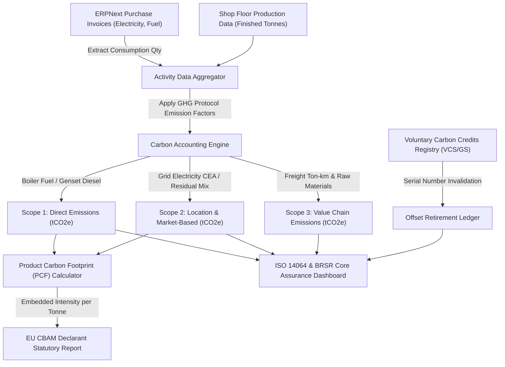

# Frappe GHG Protocol Scope 1, 2, 3 MRV & EU CBAM Carbon Engine

[](https://frappeframework.com/)
[]()
[]()
[]()
[](LICENSE)

## 📌 Executive Overview & Real-World Client Problem

Industrial manufacturers exporting to the European Union (EU) face the **Carbon Border Adjustment Mechanism (CBAM - Regulation 2023/956)** covering steel, aluminum, cement, fertilizers, hydrogen, and electricity. Additionally, domestic public companies face mandatory **SEBI BRSR Core** assurance.

Enterprises struggle with:
1. **Activity-Data Aggregation Blindness:** Capturing primary fuel activity data for **Scope 1 (direct combustion)**, **Scope 2 (purchased electricity)**, and **Scope 3 (upstream freight and supply chain)** is prone to human error in disconnected spreadsheets.
2. **CBAM Embedded Emissions Intensity:** Failure to compute exact specific embedded emissions ($tCO_2e$ per metric ton of steel/aluminum) forces EU customs authorities to apply punitive default carbon intensity values and high cross-border carbon border tariffs.
3. **Double-Counting in Carbon Offsetting:** Retiring voluntary carbon credits (Verra VCS, Gold Standard) without permanent serial number invalidation triggers greenwashing litigation.

This Frappe application implements an enterprise Carbon MRV (Measurement, Reporting, and Verification) accounting platform.

---

## 🏛️ System Architecture Flow



---

## 🚀 Key Engineering Capabilities

- **GHG Protocol Standard Activity Engine:** Converts physical units (diesel liters, natural gas SCM, grid kWh, air freight ton-km) into standardized metric tons of $CO_2$ equivalent ($tCO_2e$).
- **EU CBAM Embedded Footprint Calculator:** Computes product carbon footprints per metric ton of finished goods, ready for European customs declarant portals.
- **Offset Retirement Ledger:** Tracks carbon offset purchases, registry serial numbers (Verra / Gold Standard), and ensures audited retirement.
- **Audit-Ready ESG Export:** Prepares formatted disclosures compliant with ISO 14064, GHG Protocol Corporate Standard, and SEBI BRSR Core.

---

## 📂 Frappe DocType Schema & Data Structure

```text
carbon_mrv_ghg/
├── carbon_mrv_ghg_core/
│   ├── doctype/
│   │   ├── carbon_mrv_ledger/
│   │   │   ├── carbon_mrv_ledger.json
│   │   │   ├── carbon_mrv_ledger.py
│   │   └── carbon_mrv_ledger.js
│   │   └── cbam_product_footprint/
│   │       └── cbam_product_footprint.json
│   └── workspace/
│       └── carbon_mrv_ghg_workspace/
│           └── carbon_mrv_ghg_workspace.json
```

---

## ⚡ Frappe Hooks & Whitelisted APIs

- **REST Endpoint:** `POST /api/method/carbon_mrv_ghg.api.compute_embedded_cbam_footprint`
- **Whitelisted Method:** `@frappe.whitelist() def retire_verified_carbon_offsets(registry_serial_no, offset_tco2e)`
- **Hooks Event:** `on_submit` of `Purchase Invoice` (Fuel/Electricity) auto-creates carbon activity entries.

---

## 🛠️ Installation & Bench Setup

```bash
bench get-app https://github.com/shyampandey1104/frappe-carbon-credit-mrv-ghg-protocol-engine
bench --site erp.yourdomain.com install-app carbon_mrv_ghg
bench --site erp.yourdomain.com migrate
python3 -m unittest discover tests
```

---

## 📄 License
MIT License. Built for heavy industry exporters, ESG sustainability consultants, and carbon accountants.
